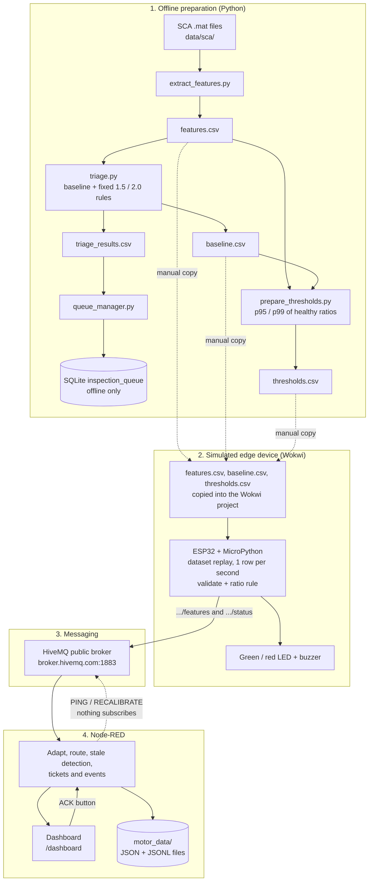

# Maintenance Triage Assistant

A prototype that turns vibration measurements into a **priority-ordered inspection list**, so a technician can see which machines need an inspection now and which only need watching.

The project has two parts that share the same data and rule idea:

1. **An offline Python pipeline** that extracts vibration features from the SCA bearing dataset, calibrates a per-machine baseline, applies rule-based triage and keeps a SQLite inspection queue.
2. **A simulated edge-to-dashboard demo**: an ESP32 (MicroPython, simulated in Wokwi) replays recorded dataset rows over MQTT to a Node-RED backend with a dashboard, alarm tickets and acknowledgment.

> **Honest summary of what this is.** The demo replays **recorded dataset rows**. It does not read a live sensor. Triage decisions are **rule-based thresholds on the RMS ratio**; no machine-learning model is trained or used. The thresholds are calibrated on the SCA data only and have not been validated on any real machine.

---

## Table of Contents

1. [Problem Statement](#1-problem-statement)
2. [What the Project Delivers](#2-what-the-project-delivers)
3. [System Architecture](#3-system-architecture)
4. [End-to-End Workflow](#4-end-to-end-workflow)
5. [Technologies](#5-technologies)
6. [Dataset and Feature Engineering](#6-dataset-and-feature-engineering)
7. [Baseline Calibration and Triage Methodology](#7-baseline-calibration-and-triage-methodology)
8. [Offline Inspection Queue (SQLite)](#8-offline-inspection-queue-sqlite)
9. [ESP32 / Wokwi Simulation](#9-esp32--wokwi-simulation)
10. [MQTT Communication](#10-mqtt-communication)
11. [Node-RED Backend and Dashboard](#11-node-red-backend-and-dashboard)
12. [Results, Interpretation and Limitations](#12-results-interpretation-and-limitations)
13. [Repository Structure](#13-repository-structure)
14. [Installation and Reproduction](#14-installation-and-reproduction)
15. [Troubleshooting](#15-troubleshooting)
16. [Future Improvements](#16-future-improvements)

---

## 1. Problem Statement

Rotating machinery produces continuous vibration data, and nobody can watch raw signals for every machine. Alerting on every deviation creates noise; ignoring deviations risks missed faults. The idea is to compare each new reading against what is *normal for that specific machine and sensor*, and surface only the readings that deserve attention, ranked by urgency.

## 2. What the Project Delivers

- **Feature extraction** from raw vibration signals (RMS, peak-to-peak, kurtosis, crest factor).
- **Per-asset, per-sensor baselines** from healthy reference data.
- **Transparent rule-based triage** with the statuses `NORMAL`, `OBSERVE` and `INSPECT`, plus `EXCLUDED` and `NO_BASELINE` in the offline pipeline.
- **Per-asset/sensor calibrated thresholds** (95th and 99th percentile of healthy ratios) used by the simulated device.
- **An ESP32 replay simulation** that validates rows, runs the same ratio rule on-device, drives LEDs and a buzzer, and publishes over MQTT.
- **A Node-RED flow and dashboard** with alarm tickets, event history, stale-data detection, acknowledgment and file persistence.
- **A separate offline SQLite inspection queue** with acknowledgment.

## 3. System Architecture



Solid arrows are data paths that exist in the code. Dotted arrows are manual steps or paths that have no receiver (see [Limitations](#12-results-interpretation-and-limitations)). The SQLite queue in part 1 is **not connected** to Node-RED; the live demo uses Node-RED's own ticket store.

## 4. End-to-End Workflow

1. **Extract features** from the `.mat` files into `features.csv`.
2. **Build baselines** (median RMS of healthy training rows per asset and sensor) and run the fixed-threshold offline triage, producing `baseline.csv` and `triage_results.csv`.
3. **Calibrate thresholds** with `prepare_thresholds.py`, producing `thresholds.csv` (one `observe_ratio` and `inspect_ratio` per asset/sensor).
4. **Load** `features.csv`, `baseline.csv` and `thresholds.csv` into the Wokwi ESP32 project.
5. **Replay**: the ESP32 picks one `test` row per second, validates it, computes `rms_ratio = rms / baseline_rms`, classifies it, lights the LEDs, and publishes a features message and a status message to MQTT.
6. **Process** in Node-RED: map the status to a condition and priority, update the dashboard state, create tickets and events, log telemetry and persist tickets and events.
7. **Detect staleness**: every 5 seconds Node-RED checks the age of the last message and marks the device offline when data stops.
8. **Acknowledge** a ticket from the dashboard.

## 5. Technologies

| Area | Tool |
|---|---|
| Offline pipeline | Python 3, NumPy, pandas, SciPy (`scipy.io.loadmat`) |
| Persistence (offline) | SQLite |
| Dataset | SCA Bearing Dataset (v2) |
| Edge simulation | Wokwi, ESP32 DevKit C v4, MicroPython 1.28.0 (`umqtt.simple`) |
| Simulated parts | MPU6050 IMU, DS18B20 temperature sensor, 2 LEDs, buzzer |
| Messaging | MQTT 3.1.1 over the public HiveMQ broker (`broker.hivemq.com:1883`) |
| Backend and UI | Node-RED with Dashboard 2.0 nodes (`ui-base`, `ui-chart`, `ui-template`) |

## 6. Dataset and Feature Engineering

### Dataset

The SCA Bearing Dataset is expected under `data/sca/<asset_id>/train.mat` and `test.mat` (not tracked in Git). The local copy used here has **22 `.mat` files**: 11 asset folders, each with a train and a test file.

Observed structure (`inspect_data.py`, `summarize_sca.py`, `sca_summary.txt`):

- Sensor groups are stored as structs: `FS` and `DS` in most files, `Upper` and `Lower` in folder 7, and only `DS` in folders 5 and 10.
- Each struct holds `assetName`, `faultFrequencies`, `unit`, `rawData`, `samplingRate`, `RPM`, `time` and `label`.
- Sampling rates range from 512 Hz to 12,800 Hz depending on the asset.
- Most signals have 16,384 samples; folders 3 and 9 (test) use 8,192.
- Label values present: `-1`, `0`, `1`, `2`, `3`. Label `0` is the most common and is treated as healthy; `-1` is treated as excluded.

> The meaning of label values `1`, `2` and `3` and the measurement unit are **not documented** in this repository. The replay payload therefore reports `unit` as `"unknown"`.

### Feature engineering (`extract_features.py`)

For every valid signal the script computes:

| Feature | Used in decisions? |
|---|---|
| RMS | **Yes** (the only feature used) |
| Peak-to-peak | No (computed and published) |
| Kurtosis (Fisher=False) | No (computed and published) |
| Crest factor (peak / RMS) | No (computed and published) |

Each row also carries: `asset_id` (parent folder name), `split` (file stem), `sensor`, `signal_index`, `label`, `sampling_rate`, `rpm` and `signal_length`. Signals with fewer than two samples or non-finite values are skipped. Output header:

```text
asset_id,split,sensor,signal_index,label,sampling_rate,rpm,signal_length,rms,peak_to_peak,kurtosis,crest_factor
```

## 7. Baseline Calibration and Triage Methodology

### Baseline (`triage.py`)

For each `(asset_id, sensor)` pair the baseline is the **median RMS of training rows with `label == 0`**. It is written to `data/baseline.csv` (`asset_id, sensor, baseline_rms, baseline_count`).

`rms_ratio = rms / baseline_rms` (set to NaN when the baseline is not greater than 0).

### Two threshold schemes

The project currently has **two separate threshold schemes**. They are not unified.

| | Offline triage (`triage.py`) | Simulated device (`main.py` + `prepare_thresholds.py`) |
|---|---|---|
| OBSERVE | `rms_ratio >= 1.5` | `rms_ratio >= observe_ratio` for that asset/sensor |
| INSPECT | `rms_ratio >= 2.0` | `rms_ratio >= inspect_ratio` for that asset/sensor |
| Source | Hard-coded experimental demo values | 95th and 99th percentile of healthy training ratios (`label == 0`, `split == train`), minimum 20 samples per group |
| Output | `data/triage_results.csv` | `data/thresholds.csv` |

`triage.py` does **not** read `thresholds.csv`. The hard-coded `1.5` / `2.0` values are marked in the code as experimental demo values, not machine safety limits.

### Offline status rules and priority (`triage.py`)

| Status | Condition | Priority |
|---|---|---|
| `INSPECT` | `rms_ratio >= 2.0` | 1 |
| `OBSERVE` | `rms_ratio >= 1.5` | 2 |
| `NORMAL` | otherwise | 3 |
| `NO_BASELINE` | no baseline for the asset/sensor | 4 |
| `EXCLUDED` | `label == -1` | 5 |

Results are sorted by priority, then by descending `rms_ratio`.

### Calibrated thresholds (`prepare_thresholds.py`)

Per asset/sensor group, ratios of healthy training rows are computed against the baseline; `observe_ratio` is their 95th percentile and `inspect_ratio` their 99th percentile (raised to at least the observe value). Groups with fewer than 20 healthy rows are skipped. `thresholds.csv` currently contains 19 groups. Excerpt:

| asset_id | sensor | observe_ratio | inspect_ratio | normal_count |
|---|---|---|---|---|
| 1 | DS | 1.202112 | 1.298283 | 122 |
| 3 | FS | 1.247698 | 2.436633 | 119 |
| 4 | FS | 1.102769 | 1.506007 | 122 |
| 6 | DS | 1.037838 | 1.09578 | 157 |
| 11 | DS | 1.081746 | 1.110291 | 127 |

Because these thresholds come from the same training rows that define the baseline, they describe the healthy training spread, not detection performance.

## 8. Offline Inspection Queue (SQLite)

`queue_manager.py` maintains a SQLite table `inspection_queue`:

- `initialize()` creates the table with a uniqueness constraint on asset, sensor, split and signal index.
- `sync_queue()` reads `triage_results.csv`, keeps only `OBSERVE` and `INSPECT`, skips rows missing `baseline_rms` or `rms_ratio`, upserts the rest and removes entries that are no longer active.
- `show_queue()` prints the queue by ascending priority, then descending ratio.
- `acknowledge()` records the technician name and a timestamp.

Acknowledge an alert from the command line:

```bash
python -c "from queue_manager import acknowledge; acknowledge(1, 'Technician 1')"
```

## 9. ESP32 / Wokwi Simulation

**Operating mode: CSV dataset replay, not live sensing.** Project link: <https://wokwi.com/projects/477694060801030145> (also referenced in `esp32 circuit/wokwi-project.txt`).

### Circuit (`esp32 circuit/diagram.json`)

| Part | Pin(s) |
|---|---|
| ESP32 DevKit C v4 (MicroPython `v1.28.0`) | n/a |
| MPU6050 IMU | SDA = GPIO 21, SCL = GPIO 22 |
| DS18B20 temperature sensor | DQ = GPIO 4 |
| Green LED | GPIO 27 |
| Red LED | GPIO 13 |
| Buzzer | GPIO 23 |

> The MPU6050 and DS18B20 appear in the wiring diagram, but **`main.py` does not read them**. The firmware only replays `features.csv`.

### Firmware behavior (`esp32 circuit/main.py`)

- **Inputs:** `features.csv` (only `split == test` rows are published), `baseline.csv`, `thresholds.csv`. A threshold entry is rejected if `normal_count < 20` or `inspect < observe`.
- **Replay:** with `RANDOM_REPLAY = True` (default) it seeks to random positions in the file and takes the next `test` row, avoiding the last 60 offsets; with `False` it replays rows in file order and restarts. One row is published every `REPLAY_INTERVAL_MS = 1000`.
- **Network:** Wi-Fi SSID `Wokwi-GUEST` (open network, no credentials). Wi-Fi retries every 10 s, MQTT every 2 s; rows are not consumed while the connection is down.
- **Validation:** `rms`, `peak_to_peak`, `kurtosis`, `crest_factor`, `rpm` and `sampling_rate` must be numeric; `rms` and `peak_to_peak` must not be negative; `rpm` and `sampling_rate` must be positive.
- **Decision:** `rms_ratio = rms / baseline_rms`; `>= inspect_ratio` gives `INSPECT`, `>= observe_ratio` gives `OBSERVE`, otherwise `NORMAL`. Missing baseline or threshold gives `NO_BASELINE` or `NO_THRESHOLD`. Only RMS is used.
- **Outputs:** green LED for `NORMAL`; red LED for `OBSERVE`, `INSPECT` and invalid states; a 120 ms buzzer pulse for `INSPECT`.
- **Optional:** `EVALUATE_ON_BOOT = True` prints false-alarm and detection statistics from test labels before connecting (off by default; publishes nothing).

## 10. MQTT Communication

- **Broker:** `broker.hivemq.com`, port `1883`, plain TCP, **no TLS, no username or password**. It is a public broker, so anyone can read or publish to these topics.
- **Client ID:** `triage-replay-<random hex>`, keepalive 60 s.
- **QoS / retain / Last Will:** not set by the firmware (QoS 0, no retain, no Last Will).
- **Device ID:** `asset-<asset_id>-<sensor>-muhammeedd1`. One simulated ESP32 therefore publishes as many different device IDs as there are asset/sensor combinations.

### Topics

| Topic | Direction | Used by |
|---|---|---|
| `muhammeedd1/triage/<device_id>/features` | ESP32 publishes | Node-RED subscribes (`.../+/features`, QoS 0) |
| `muhammeedd1/triage/<device_id>/status` | ESP32 publishes | Node-RED subscribes (`.../+/status`, QoS 1) |
| `muhammeedd1/triage/+/event` | nobody publishes | Node-RED subscribes (never fed by the replay) |
| `ahmed-yasser/motor01/command` | Node-RED publishes | **Nothing subscribes** (the ESP32 subscribes to no topic) |

### Message structure

The examples below are **illustrative**: they are assembled from the fields in `main.py` and the first row of `features.csv`. The `timestamp_ms` value is arbitrary and the `reason` text depends on the firmware.

Features message:

```json
{
  "device_id": "asset-1-FS-muhammeedd1",
  "asset_id": "1",
  "sensor": "FS",
  "signal_index": 0,
  "timestamp_ms": 123456,
  "source": "dataset_replay",
  "unit": "unknown",
  "sampling_rate_hz": 640.0,
  "rpm": 1144.63354,
  "features": {
    "rms": 0.056801,
    "peak_to_peak": 0.469382,
    "kurtosis": 2.946277,
    "crest_factor": 4.298322
  },
  "valid": true,
  "triage_preview": {
    "status": "NORMAL",
    "rms_ratio": 0.9708,
    "observe_threshold": 1.206196,
    "inspect_threshold": 1.349734,
    "reason": "..."
  },
  "ground_truth_label": 0,
  "split": "test"
}
```

Status message (sent after every features message, so it is **not** a periodic heartbeat):

```json
{
  "device_id": "asset-1-FS-muhammeedd1",
  "state": "online",
  "source": "dataset_replay",
  "timestamp_ms": 123456
}
```

`ground_truth_label` is included in the published payload because this is a replay simulation. The Node-RED triage logic reads `triage_preview.status`, not the label.

## 11. Node-RED Backend and Dashboard

The flow is `Json/final_flow_SCA_replay.json` (one tab, "Maintenance Triage - SCA Replay"). It connects to the HiveMQ broker above; the export contains no credentials.

### What the flow does

- **Adapt, triage and route.** Parses each features message and drops it if `device_id`, `features` or `triage_preview` is missing. It does **not** re-run triage: it maps the device's `triage_preview.status` to a condition and priority.

  | Device status | Condition | Priority |
  |---|---|---|
  | `NORMAL` | `NORMAL` | `NONE` |
  | `OBSERVE` | `OBSERVE` | `LOW` |
  | `INSPECT` | `INSPECT` | `HIGH` |
  | `INVALID_DATA`, `NO_BASELINE`, `NO_THRESHOLD`, other | `SENSOR_ERROR` | `HIGH` |

- **Tickets.** A ticket (`ALM-<timestamp>-<n>`) is created on a transition to `INSPECT` or `SENSOR_ERROR`, de-duplicated against open (`NEW`) tickets of the same type. Three consecutive invalid windows create an `INVALID_WINDOWS` ticket. Returning to `NORMAL` clears open condition tickets. `OBSERVE` creates an event but no ticket.
- **Events.** "Condition changed to ..." events, device status events and runtime errors are kept (capped at 50) with Info, Warning or Fault severity.
- **Stale-data detection.** A 5-second timer checks the age of the last message. After 15 s the device is shown as `OFFLINE`; after 30 s a `DEVICE_OFFLINE` ticket is created. Telemetry returning clears it.
- **Dashboard actions.** `ACK` marks a ticket `ACKNOWLEDGED` with a timestamp and user name. `PING` and `RECALIBRATE` publish to the command topic (see limitations).
- **Persistence.** Tickets and events are saved to `motor_data/motor_tickets.json` and `motor_data/motor_events_snapshot.json` and restored at startup. Telemetry and events are appended daily to `motor_data/motor_telemetry_<date>.jsonl` and `motor_data/motor_events_<date>.jsonl`. The live state object is in memory only and resets on restart.

### Dashboard (`/dashboard`, "Industrial Dark" theme)

| Page | Content |
|---|---|
| Home | Motor condition, device details, five gauges, sparklines, recent events, Recalibrate and Ping buttons |
| Alarms & Tickets | Filterable tickets table, event history, per-ticket Acknowledge and "Acknowledge all" |
| KPIs & Motor | KPI cards (RMS, ratio, sample rate, completeness, data status and others) |
| System Trends | Eight time-series charts over a 30-minute window |

### What is live and what is not

| Indicator | Behavior in the replay |
|---|---|
| RMS, baseline, deviation ratio, sample rate, condition, tickets, events | **Live** from MQTT messages |
| Online / stale / offline state | **Derived** from message arrival time |
| Motor temperature, MPU temperature, AC peak, sample count | **Always empty** (fields are `null`; the firmware does not read the simulated sensors) |
| Calibration "COMPLETED", 12 windows, completeness 100 %, firmware "SCA replay" | **Hard-coded constants**, not measurements |
| Recalibrate and Ping buttons | **No effect on the ESP32** (see limitations) |

## 12. Results, Interpretation and Limitations

### Offline run with fixed thresholds (1.5 / 2.0)

These counts were recorded in the project's previous README for the full dataset; they were not re-run for this document.

| Status | Records |
|---|---|
| NORMAL | 5,048 |
| INSPECT | 980 |
| OBSERVE | 418 |
| EXCLUDED | 198 |
| **Total** | **6,644** |

**Interpretation.** These counts show how many records the rules flag. They are **not** a measure of fault-detection accuracy. Many `INSPECT` records carry label `0` (healthy), so the single fixed-ratio rule raises alerts on records the dataset considers healthy. That is the reason for the per-asset calibrated thresholds used by the simulated device.

**Not yet documented:** no detection or false-alarm figures are recorded for the calibrated thresholds. Setting `EVALUATE_ON_BOOT = True` in `main.py` prints them from the test labels; record those numbers here once measured.

### Current limitations

**Decision logic**
- Decisions use RMS only; kurtosis, crest factor and peak-to-peak are computed but unused.
- One baseline per asset/sensor ignores RPM and operating conditions.
- Two unlinked threshold schemes exist (fixed offline, percentile-based in the demo).
- Thresholds are calibrated on the same training rows that define the baseline; there is no held-out evaluation.
- If `baseline_rms` is not positive, `triage.py` sets the ratio to NaN and the row stays `NORMAL` instead of `NO_BASELINE`.
- Label semantics (other than `0` and `-1`) and the unit are unknown.

**Simulation and messaging**
- Dataset replay only; the MPU6050 and DS18B20 are wired in the diagram but unused.
- The public broker has no authentication or encryption, no QoS above 0 for features, no retained messages and no Last Will. Offline detection relies only on the stale timer.
- Status messages are not heartbeats; they are sent only alongside data.

**Node-RED and dashboard**
- The command topic `ahmed-yasser/motor01/command` differs from the replay's topic root and the ESP32 subscribes to nothing, so **PING and RECALIBRATE cannot reach the device**.
- The `CRITICAL` condition is unreachable from the replay.
- The device-event handler only accepts `MOTOR_01` and the stale-data ticket uses `MOTOR_01`, while replay devices are named `asset-<id>-<sensor>-muhammeedd1`. The flow keeps a single shared state object, so the dashboard shows whichever device published last rather than one panel per asset.
- Several widgets show constants or empty values (see the live/not-live table).
- The SQLite queue and Node-RED tickets are separate and not synchronized.

## 13. Repository Structure

```text
Maintenance-Triage-Assistant/
├── extract_features.py        # .mat -> features.csv
├── triage.py                  # baseline + fixed-threshold offline triage
├── prepare_thresholds.py      # per-asset/sensor p95/p99 thresholds -> thresholds.csv
├── queue_manager.py           # offline SQLite inspection queue + acknowledgment
├── inspect_data.py            # .mat structure inspection helper
├── summarize_sca.py           # .mat dataset summary helper
├── sca_summary.txt            # dataset structure summary
├── esp32 circuit/             # Wokwi project: main.py, diagram.json, wokwi-project.txt,
│   │                          #   features.csv, baseline.csv, thresholds.csv
├── Json/
│   └── final_flow_SCA_replay.json   # Node-RED flow + dashboard export
├── Files/                     # copies of generated CSVs
│                              #   (baseline, features, thresholds, triage_results)
├── package-lock.json          # no package.json found; likely unused
├── .gitignore                 # excludes data/, .venv/, __pycache__/, local DBs, .env
└── README.md
```

`data/` (dataset and generated outputs) is excluded from Git. The CSVs in `Files/` and `esp32 circuit/` are committed copies so the demo can run without the dataset.

## 14. Installation and Reproduction

### A. Offline pipeline

```bash
git clone https://github.com/muhammeedd1/Maintenance-Triage-Assistant.git
cd Maintenance-Triage-Assistant

python -m venv .venv
# Windows:      .venv\Scripts\activate
# Linux/macOS:  source .venv/bin/activate

pip install numpy pandas scipy
```

Place the SCA dataset under `data/sca/<asset_id>/train.mat` and `test.mat`, then run in this order:

```bash
python summarize_sca.py       # optional: inspect the .mat files
python extract_features.py    # -> data/features.csv
python triage.py              # -> data/baseline.csv, data/triage_results.csv
python prepare_thresholds.py  # -> data/thresholds.csv
python queue_manager.py       # optional: build and print the SQLite queue
```

### B. Simulated device (Wokwi)

1. Open <https://wokwi.com/projects/477694060801030145>, or create an ESP32 MicroPython project and upload the files from `esp32 circuit/` (`main.py`, `diagram.json`, `features.csv`, `baseline.csv`, `thresholds.csv`).
2. To use freshly generated data, replace the three CSVs with those from `data/`.
3. Start the simulation. The serial monitor should show Wi-Fi and MQTT connecting, then one row published per second.

### C. Node-RED backend and dashboard

1. Install Node.js and Node-RED, and install the Dashboard 2.0 package (`@flowfuse/node-red-dashboard`) from the palette manager.
2. Import `Json/final_flow_SCA_replay.json` and deploy. Node-RED needs internet access to reach `broker.hivemq.com`.
3. Open `http://localhost:1880/dashboard` (default Node-RED port).
4. The `motor_data/` files are written relative to Node-RED's working directory; make sure it is writable.

### D. Run the demonstration

1. Deploy the Node-RED flow and open the dashboard.
2. Start the Wokwi simulation.
3. Watch the Home page update (RMS, ratio, condition) and the charts fill.
4. When an `INSPECT` reading appears, open **Alarms & Tickets** and acknowledge the ticket.
5. Stop the simulation and wait 15 s (device shown offline) and 30 s (offline ticket created).

To inspect raw traffic: `mosquitto_sub -h broker.hivemq.com -t "muhammeedd1/triage/#" -v`

## 15. Troubleshooting

| Symptom | Likely cause |
|---|---|
| `FileNotFoundError` in the inspection scripts | No `.mat` files under `data/sca/` |
| `extract_features.py` finds no valid signals | Wrong dataset layout or unreadable files |
| `prepare_thresholds.py` raises `RuntimeError` | No asset/sensor group has 20 or more healthy training rows |
| Empty SQLite queue | `triage.py` was not run first, or no `OBSERVE` / `INSPECT` rows exist |
| Wokwi never publishes | Wi-Fi or broker not reachable; check the serial monitor. The firmware sets the MQTT client to `None` if `umqtt.simple` cannot be imported |
| Dashboard shows no data | Flow not deployed, no internet access to the broker, or the simulation is not running |
| Dashboard shows OFFLINE or STALE | No message for more than 15 s; the simulation stopped or the connection dropped |
| Runtime errors about `motor_data/...` files | Directory missing or not writable in Node-RED's working directory |
| Temperature or peak widgets are empty | Expected: the replay does not provide these fields |
| Recalibrate / Ping appear to do nothing | Expected: the device does not receive commands |

## 16. Future Improvements

These are proposals, not implemented features:

- Align the command topic and add an ESP32 subscriber, or remove the Recalibrate and Ping buttons.
- Add a Last Will message and periodic heartbeats for reliable offline detection.
- Remove or relabel hard-coded dashboard constants and empty widgets, or feed them from real sensor readings.
- Read the MPU6050 and DS18B20 for live acquisition instead of dataset replay.
- Unify the two threshold schemes and evaluate the calibrated thresholds on held-out data, reporting detection and false-alarm rates per label.
- Use more features (kurtosis, crest factor, peak-to-peak) and condition baselines on RPM.
- Show one dashboard state per asset and sensor, and remove the `MOTOR_01` assumptions.
- Connect the offline SQLite queue and Node-RED tickets, or drop one of them.
- Use a private broker with authentication and TLS.
- Add automated tests for triage, thresholds and queue logic.

---

*Educational project. Thresholds and results are demonstration values and must not be used for real safety decisions.*
